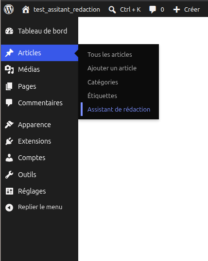
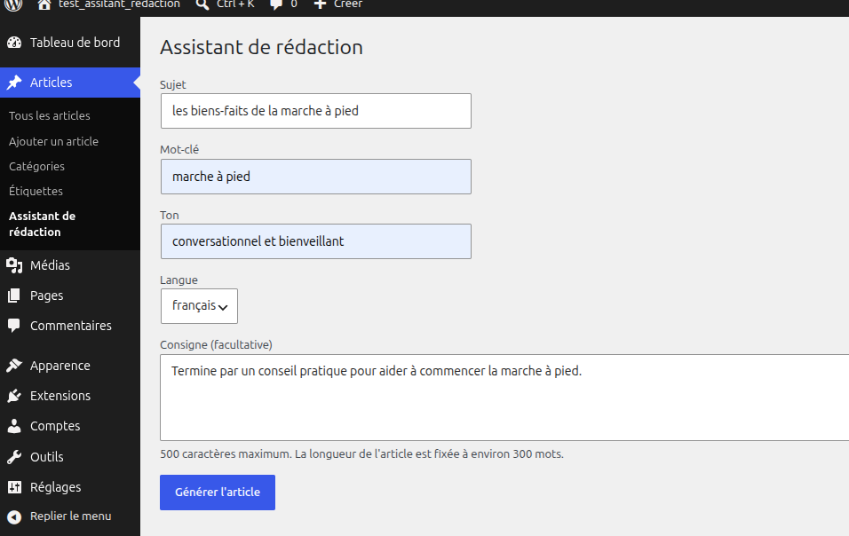
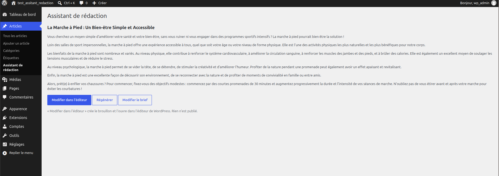
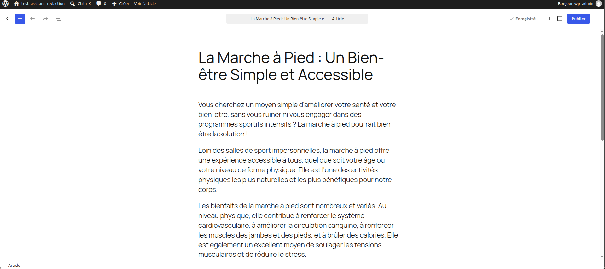
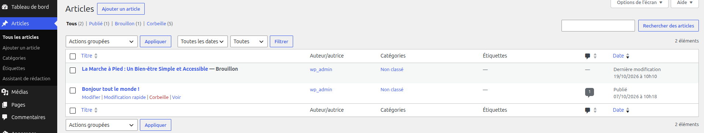

# Démo : brief > proposition > brouillon

[← Retour au README](../../README.md)

**1. Accès à l'écran** : *Articles > Assistant de rédaction*

**2. Saisie du brief** : sujet, mot-clé, ton, langue, consigne facultative

**3. Relecture de la proposition** (environ 1 min de génération sur CPU) : trois choix possibles

**4. « Modifier dans l'éditeur »** : le brouillon s'ouvre dans l'éditeur WordPress, il n'est pas publié

**5. Vérification** : l'article apparaît en **Brouillon** dans la liste des articles

